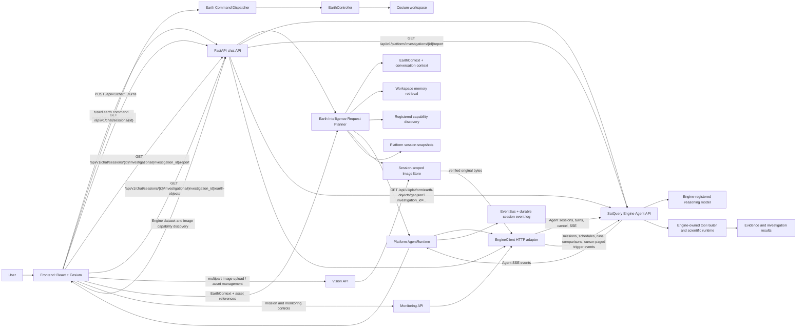

# Architecture overview

## Principles

1. **The Engine is a dependency, not part of the Platform.** All contact goes through
   `engine.EngineClient`. Nothing else imports Engine code. (ADR 0001)
2. **The LLM thinks, the Engine executes.** No science runs in the Platform or in a prompt. (ADR 0002)
3. **The Earth is the workspace.** The globe is mounted once and persists; the UI floats above it, and
   the backend can drive it with typed commands. (ADR 0003)
4. **One wire contract.** Events, Earth commands and shared models are defined once in pydantic,
   exported to `contracts/schema.json`, and generated into TypeScript. The two sides cannot drift.
5. **Extension points use registries.** Backend plugin loading and frontend module loading remain
   contracts, not active runtime capabilities.
6. **Dependencies point down.** Enforced mechanically, not by convention.

## Runtime view

## Phase 2 Agent turn, end to end

1. The user selects a Platform session and submits text and optional selected image asset IDs.
   Investigation execution authorization is
   off by default; the UI checkbox is explicit per-turn consent. The client also sends its current
   typed EarthContext and provider-neutral vision metadata/asset references when present.
2. The chat API verifies the Platform session and configured Engine model id. The Request Planner
   reads the Engine-owned transcript, builds and persists a bounded Platform EarthContext snapshot,
   retrieves existing Platform records, resolves asset metadata by session-owned IDs, discovers
   registered/configured capabilities, and estimates context size.
3. If EarthContext exists, the planner budgets its model-relevant fields separately from the message.
   The Engine request carries a typed context containing camera/view scope, time, selection,
   user-created drawings, and selected evidence references. Local rendering state is not sent.
   If image IDs are present, the route resolves the originals from the session-owned image store
   and sends typed attachment metadata and bytes separately from message text.
4. `AgentRuntime` lazily creates and persists the matching Engine Agent session id for older and new
   Platform sessions. Concurrent initialization of the same Platform session is single-flight;
   independent sessions initialize concurrently. `EngineClient` sends the planned message, model id,
   consent flag, structured EarthContext, and optional images to
   `POST /api/v1/agent/sessions/{id}/turns`. SatQuery Engine owns model selection, tool calls,
   scientific execution, and transcript persistence.
5. The adapter parses Engine SSE events into typed boundary models. `AgentRuntime` preserves
   ordinary Engine events as opaque `engine.event` records. It validates `earth.command` against the
   shared command schema, stores it as `EarthCommandIssued`, and forwards it for workspace dispatch.
6. The frontend renders assistant deltas and Engine tool/progress status. On session revisit, it
   fetches the authoritative transcript from the Engine Agent session. Investigation IDs from that
   transcript are the only report links shown; a report request is checked against the session's
   current Engine transcript before the existing Engine report endpoint is called. The Platform
   validates and returns the Engine report identity, digest, and Markdown without interpreting
   observations or constructing scientific claims.
7. The user can load an investigation's Engine-exported Earth Object GeoJSON through a similarly
   session-scoped route. The Engine export includes only explicitly materialized, valid WGS 84
   geometries and reports omitted objects. The Engine exposes the investigation's append-only
   execution journal through a bounded cursor page after verifying Agent-session ownership; journal
   integrity is checked before a page is returned. The frontend renders the FeatureCollection as a
   transient Cesium data source, displays typed evidence IDs on feature selection, highlights
   matching loaded evidence on request, and removes owned sources when the session changes or its
   EarthController is destroyed. No reprojection, geometry repair, or scientific interpretation
   occurs in the Platform.
8. Stop calls the Platform cancel route, which delegates to the Engine Agent session's cancellation
   endpoint. The browser aborts its local event stream only after that request completes; a failed
   cancellation is shown to the user rather than treated as a successful Engine stop.

The same planner is inspectable without starting a turn at
`POST /api/v1/chat/sessions/{id}/plan`. The Platform memory search endpoint is
`GET /api/v1/intelligence/sessions/{id}/memory?query=...`; runtime capability facts are available
at `GET /api/v1/intelligence/capabilities`.

The Engine Agent exposes `earth.command` as an explicit presentation tool and emits a typed event
with the existing session/turn/sequence/timestamp envelope. The Platform validates and maps this to
the shared `EarthCommandIssued` event before persistence and frontend dispatch. The first supported
commands are `fly_to` and `show_investigation`; Engine and Platform both enforce investigation
session ownership. Commands are never inferred from assistant prose or tool outputs. Other command
types remain unavailable until their Engine data contracts exist. See the
[Phase 3 and Phase 4 roadmap](roadmap.md).

The Phase 4 timeline is a presentation-owned EarthController slice. Its UI changes the Cesium clock,
and viewport and clock state are mirrored into the frontend EarthContext store. Phase 6 sends a
bounded typed workspace snapshot with the Engine turn, including camera and viewport, timeline,
selection, drawings, imagery references, primary and secondary view state, visible overlay geometry,
evidence highlights, investigation references, and the remaining serializable workspace state. The Engine treats every value as
untrusted scope, not evidence. Image bytes remain separate transient attachments. The Cesium viewer
uses request-driven rendering, allowing static views to remain idle while camera, scene, timeline,
and overlay changes request frames. The Engine's verified GeoJSON export remains the source for
canonical Earth Object overlays; paged investigation history comes from the Engine execution journal.
Layer rendering still requires typed Engine-owned source data. The Platform does not derive these
from opaque tool results.

Phase 4 workspace state is kept separate from Engine-owned session transcripts. The Platform's
session record has an `earth_workspace` value persisted through the existing session API and SQLite
store: bounded camera history and named EarthContext bookmarks. EarthController owns Cesium picking,
draw interaction, terrain-height queries, camera restoration, and entity rendering; the frontend
state stores only serializable selection/drawing values. A typed Earth event bus publishes selection
and drawing changes to every active view. Split view creates a second EarthController that shares
presentation events and timeline state while cameras remain independent unless the user enables
synchronization. Each controller releases its Cesium clock listener and other owned subscriptions
when its viewport is destroyed.
Session field changes use repository mutations that read, apply, and persist under one SQLite write
transaction, so concurrent workspace, planner-snapshot, and Engine-link updates preserve unrelated
fields.

Distance, area, coordinate inspection, and optional terrain elevation are local workspace
measurements, not Engine evidence. User-created GeoJSON drawings remain EarthContext presentation
objects and never start an investigation. The Engine receives bounded typed presentation state as
untrusted per-turn scope; the Platform does not synthesize investigation overlays or scientific
layers. Layer state remains empty until product selects renderable source kinds and approved
providers, deployment defines licensing, credentials, and source-serving endpoints, and the Engine
can publish an authoritative catalogue from those sources. Dataset acquisition metadata alone does
not identify renderable sources.

## Vision intake and preparation

Vision is a Platform-owned ingestion boundary, not a vision model or scientific subsystem. Browser
file, clipboard, drag/drop, screen-capture, and Cesium viewport-capture sources converge on the
frontend Vision module. Cesium remains hidden behind `EarthController`; a capture is recorded with
camera and timestamp metadata in the serializable EarthContext/session workspace. The current
controller captures a full viewport; the Vision UI can crop a user-selected pixel rectangle from
that image and records its pixel coordinates/dimensions. The Platform does not derive geographic
bounds from that crop.

The backend Vision API verifies the Platform session, validates image size/type/encoding, writes
original data plus thumbnails through `ImageStore`, and exposes session-scoped metadata/content
operations. The `MultimodalPreparer` resolves asset IDs from that store and returns a
`PreparedVisionPayload` with metadata and original image bytes in a provider-neutral envelope.
Image intake bounds concurrent in-process buffering, decoding, and persistence so simultaneous
uploads cannot multiply the per-image memory allowance without limit. The setting is per worker;
deployment-wide capacity scales with the number of API workers. Per-asset metadata updates are
serialized within the store instance, preserving independent concurrent field changes.
Deleting an unlinked Platform session removes its filesystem image assets before deleting the
session record, under the same per-session lock used by uploads and Engine-session initialization;
if asset cleanup fails, the session record remains available for a retry.
Client-supplied metadata can describe the image but cannot replace stored asset metadata.
The frontend cancels in-flight uploads when a session-bound Vision panel is destroyed and checks
session identity after asynchronous work before changing shared capture state; capture mutations
are rejected by the session store when their originating session is no longer active.

The chat planner resolves session-owned asset IDs against persisted metadata and the image store.
The Platform sends verified image bytes and metadata in a separate typed Engine Agent attachment
field, never in the prompt text. The Engine validates the encoding, size, MIME type, and SHA-256,
stores only the attachment reference in its transcript, and exposes the current turn's bytes to a
reasoning adapter that explicitly declares vision support. Canonical bytes remain Platform-owned;
the Platform resends selected assets on each turn. The Engine rejects an image turn before opening
the stream if its selected adapter does not support vision. Vision does no object detection,
segmentation, geolocation inference, or scientific reasoning.
The chat transcript reloads persisted attachment references as thumbnails through the owning
Platform session's image API; the Engine never becomes the durable image store.

## Phase 6 context and request planning

The `intelligence/` backend layer sits above Agent, Vision, Engine, Earth, and session modules. It
does not execute model/tool calls. Its EarthContext Builder combines the client workspace snapshot
with saved camera history, bookmarks, captures, pinned evidence references, timeline focus, and
prior Platform snapshots. The resulting Pydantic context is stored on the Platform `Session` record;
SQLite persists it in the existing JSON session payload, so no database schema migration is needed.

Conversation context is derived from the Engine transcript and has configurable message and token
limits. The history compressor keeps recent messages and may create short, extractive excerpts from
older transcript text; it does not invent a summary. This normalized history is not resent because
the Engine already owns its transcript and the current API cannot accept a replacement history or
token budget. Likewise, the token estimate is based on UTF-8 bytes divided by four, not any model's
tokenizer, and cannot measure the Engine's hidden conversation history.

Workspace memory indexes records that exist in Platform persistence: session/conversation content,
saved investigations and evidence IDs, typed investigation progress events, image metadata,
bookmarks, drawings, and EarthContext snapshots. Ranking combines word overlap, geographic
proximity, and timeline recency. No embedding model is installed, and opaque Engine tool results or
assistant prose are not parsed into science or evidence. The index is reconstructed from SQLite and
image metadata for each query; an FTS/vector-backed persistent index is a future scale extension.
Results are ordered by score, record time, then stable record ID so tied matches are reproducible
regardless of source enumeration order.
The active session's Engine transcript is included directly; cross-session conversation search
uses only Platform-persisted conversations rather than fanning out to Engine sessions. Cross-session
retrieval assumes a single trusted workspace because user/tenant authentication is not implemented;
owner filtering is required before shared-user deployment.

Capability snapshots derive provider availability from configuration plus registered factories,
tool sources and layer IDs from their registries, and workspace/command contracts from their typed
models. A present contract is not conflated with a live runtime handler. Provider vision/attachment
support and active browser Earth command handlers remain unknown when the current interfaces do not
expose them. The Engine data panel reads registered dataset metadata, image-analysis capability
status, the versioned Earth modality snapshot, and the Engine's registered Agent tool descriptors
through validated Platform boundary models. Tool descriptors are read-only and report which tools
are model-visible with or without explicit execution consent. Dataset declarations do not establish
reachability or suitability. Recommendations reference existing records only
and do not infer dataset suitability or Agent tool recommendations.

Prompt assembly is provider-neutral. It accounts for Earth, vision, and retrieved workspace context
separately from the user's message. The Engine Agent request carries supported EarthContext through
its typed per-turn field and image bytes through a separate typed attachment list.

The Engine owns its transcript; the Platform cannot replace or compact that history. The separate
Earth-command event contract is documented below. Current backend and frontend validation results
are recorded in the [implementation status](implementation-status.md).

## Boundaries that matter

| Boundary | Rule |
|---|---|
| Platform ↔ Engine | Only `engine/`; `EngineClient` delegates to the Agent API; events/results remain opaque except validated `earth.command` events |
| Platform ↔ LLM vendors | Only `llm/providers/*`; neutral `Message`/`LLMRequest`/`LLMChunk` everywhere else |
| Request planning | `intelligence/` builds context and plans; only the unchanged `EngineClient` boundary sends a turn |
| Backend ↔ Frontend | `contracts/schema.json` and the REST/stream endpoints |
| Frontend ↔ Cesium | Only `earth/`, through `EarthController` |
| Core ↔ Plugins | Only `plugins/api.py` and `frontend/src/plugins/types.ts` |

## Concurrency and lifetime

Container shutdown callbacks are registered before resource initialization, so the application
lifespan can unwind resources in reverse acquisition order even when startup fails partway through.
Chat turns currently live for the lifetime of the POST/SSE request. Engine-session initialization
uses ref-counted keyed locks, so concurrent requests for one session create at most one Engine
session while unrelated sessions do not wait behind remote creation latency; idle lock entries are
removed. Session deletion shares that lock and cannot race Engine-session linking in this process.
Session read-modify-write operations are transactional, so concurrent writers preserve fields they
do not own. The Platform persists each forwarded event before sending it, and its GET stream endpoint
supports replay by per-session sequence. A disconnected chat request closes the upstream Engine
stream; the Platform does not yet provide a durable run worker or resume an interrupted model turn.
The live bus has a bounded subscriber queue; a slow subscriber is disconnected after its backlog is
discarded and can resume from its last received sequence. Bus shutdown also discards queued live
events before signaling subscriber termination. Durable replay is loaded in ordered pages capped
by `streaming.replay_window_events`; the setting bounds each query, not total replay, so reconnects
do not silently skip old events. The Engine cancel endpoint is available through the Platform API.

## Monitoring workflow

The workspace monitoring panel calls Platform routes for Engine missions, recurring schedule
definitions, enabled state, run history, and recent-run comparisons. The Platform's `EngineClient`
models and validates these responses and returns only Engine-authored state; the Engine scheduler
creates and executes the investigations. Comparison text, digest, and limitations are displayed
without independent scientific interpretation. The panel also lists Engine notifications for
partial/failed runs, forwards acknowledgements, supports revision-checked trigger-policy edits, and
supports revision-checked edits to schedule name, supported query fields, interval, priority,
overlap policy, and optional rolling-window duration. It reads trigger lifecycle events. Query
changes retain unedited Engine query dimensions; spatial bounds are editable only for simple
rectangular queries. When configured, a rolling window ends at the persisted run start time; its
resolved bounds are stored in the run and its effective EarthQuery is passed to the Engine workflow.
Fixed query times and rolling windows are mutually exclusive. External delivery is deferred until
the Engine exposes a typed delivery configuration/lifecycle and an operator selects a provider.
Trigger activity is loaded from the Engine in cursor-paged chunks. The UI
preserves event order, filters duplicate event IDs, and refuses to combine pages across schedule
revisions or reuse a non-advancing cursor.

## Failure model

All client-visible errors derive from `PlatformError` and serialise as
`{ "error": { "code", "message", "details" } }`. Missing Engine configuration or upstream failures
are surfaced as explicit availability errors; Engine turn failures after stream start are persisted
as `run.failed` events. A missing Engine yields degraded readiness rather than a crash.

## Deliberately not decided yet

The current Engine adapter targets its published HTTP Agent API; the Engine must have a compatible
reasoning model registered, configured as `agent.model_id`. Provider SDKs are deliberately not
reimplemented or called directly by the Platform Agent runtime. Provider-backed image interpretation,
broader evidence visualization, worker recovery, authentication, and multi-worker event delivery
remain future work; see [Phase 2 status](phase-2-agent-runtime.md).
