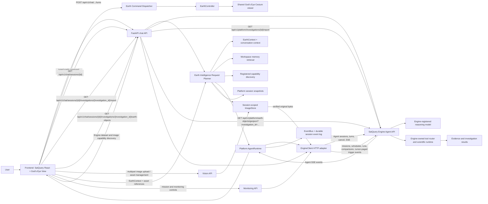

# Architecture overview

## Principles

1. **The Engine is a dependency, not part of the Platform.** All contact goes through
   `engine.EngineClient`. Nothing else imports Engine code. (ADR 0001)
2. **The LLM thinks, the Engine executes.** No science runs in the Platform or in a prompt. (ADR 0002)
3. **The Earth is the workspace.** God's Eye View is the primary Earth environment. Its Cesium
   viewer is mounted once; SatQuery's command notch mounts in God's Eye's native dock, and typed
   Platform/Engine contracts drive the shared viewer. Project and investigation routes are loaded
   on navigation. (ADR 0003)
4. **One wire contract.** Events, Earth commands and shared models are defined once in pydantic,
   exported to `contracts/schema.json`, and generated into TypeScript. The two sides cannot drift.
5. **Extension points use registries.** Backend plugin loading and frontend module loading remain
   contracts, not active runtime capabilities.
6. **Dependencies point down.** Enforced mechanically, not by convention.

## Runtime view

## Unified Earth environment

The integrated frontend uses God's Eye's authored HTML shell, styles, assets, provider middleware,
and Vite build plugins alongside SatQuery's React application. This is one same-origin page and
one Cesium viewer, not an iframe, a second globe, or a separately deployed Earth service. Vite
forwards `/api/v1` to the Platform API while God's Eye retains its provider routes.

God's Eye owns its live Earth viewer and layer lifecycle. SatQuery's `EarthController` attaches to
that viewer and adapts supported live layer visibility into the Platform's typed workspace state.
The Engine's scientific layer catalogue/source contract remains a separate unavailable capability;
the Platform does not fabricate Engine layers. God's Eye layer opacity is not supported by its
manager and is rejected when a non-default value is requested. Split view is unavailable because
the integrated runtime intentionally has one viewer. Provider keys remain scoped to their existing
client or server owners.
God's Eye visual presets and native annotation/measurement payloads remain God’s Eye-local because
the current Engine EarthContext and command contracts do not define corresponding fields; the
Platform does not infer their scientific meaning.

God's Eye also owns the active Earth workspace chrome and interactions: layer controls, scenes,
navigation, drawings, measurements, and provider settings are presented by its authored interface.
SatQuery does not mount its former Earth toolbar, timeline panel, or workspace-tools panel around
that interface. Its command notch is mounted in the native command dock as the entry point for Engine conversations and opens one
on-demand Platform workspace drawer for Projects/sessions, persisted session views, monitoring,
and read-only Engine capability discovery. Image intake remains attached to the expanded command
notch. This keeps God’s Eye's local Earth scenes distinct from Platform-persisted EarthContext
views and leaves Engine execution and scientific state with the Engine.

## Phase 2 Agent turn, end to end

1. The user selects a Platform session and submits text and optional selected image asset IDs.
   Investigation execution authorization is
   off by default; the UI checkbox is explicit per-turn consent. The client also sends its current
   typed EarthContext and provider-neutral vision metadata/asset references when present.
2. The chat API verifies the Platform session and configured Engine model id. The Request Planner
   reads the Engine-owned transcript, builds and persists a bounded Platform EarthContext snapshot,
   retrieves existing Platform records, resolves asset metadata by session-owned IDs, discovers
   registered/configured capabilities, and estimates context size.
3. If EarthContext exists, the planner budgets its model-relevant fields separately from the message.
   The Engine request carries a typed context containing camera/view scope, time, selection,
   user-created drawings, and selected evidence references. Local rendering state is not sent.
   If image IDs are present, the route resolves the originals from the session-owned image store
   and sends typed attachment metadata and bytes separately from message text.
4. `AgentRuntime` lazily creates and persists the matching Engine Agent session id for older and new
   Platform sessions. Concurrent initialization of the same Platform session is single-flight;
   independent sessions initialize concurrently. `EngineClient` sends the planned message, model id,
   consent flag, structured EarthContext, and optional images to
   `POST /api/v1/agent/sessions/{id}/turns`. SatQuery Engine owns model selection, tool calls,
   scientific execution, and transcript persistence.
5. The adapter parses Engine SSE events into typed boundary models. `AgentRuntime` preserves
   ordinary Engine events as opaque `engine.event` records. It validates `earth.command` against the
   shared command schema, stores it as `EarthCommandIssued`, and forwards it for workspace dispatch.
6. The frontend renders assistant deltas and Engine tool/progress status. On session revisit, it
   fetches the authoritative transcript from the Engine Agent session. Investigation IDs from that
   transcript are the only report links shown; a report request is checked against the session's
   current Engine transcript before the existing Engine report endpoint is called. The Platform
   validates and returns the Engine report identity, digest, and Markdown without interpreting
   observations or constructing scientific claims.
7. The user can load an investigation's Engine-exported Earth Object GeoJSON through a similarly
   session-scoped route. The Engine export includes only explicitly materialized, valid WGS 84
   geometries and reports omitted objects. The Engine exposes the investigation's append-only
   execution journal through a bounded cursor page after verifying Agent-session ownership; journal
   integrity is checked before a page is returned. The frontend renders the FeatureCollection as a
   transient Cesium data source, displays typed evidence IDs on feature selection, highlights
   matching loaded evidence on request, and removes owned sources when the session changes or its
   EarthController is destroyed. No reprojection, geometry repair, or scientific interpretation
   occurs in the Platform.
8. Stop calls the Platform cancel route, which delegates to the Engine Agent session's cancellation
   endpoint. The browser aborts its local event stream only after that request completes; a failed
   cancellation is shown to the user rather than treated as a successful Engine stop.

The same planner is inspectable without starting a turn at
`POST /api/v1/chat/sessions/{id}/plan`. The Platform memory search endpoint is
`GET /api/v1/intelligence/sessions/{id}/memory?query=...`; runtime capability facts are available
at `GET /api/v1/intelligence/capabilities`.

The Engine Agent exposes `earth.command` as an explicit presentation tool and emits a typed event
with the existing session/turn/sequence/timestamp envelope. The Platform validates and maps this to
the shared `EarthCommandIssued` event before persistence and frontend dispatch. Supported commands
are `fly_to`, `show_investigation`, and `set_layer_visibility`. The Engine and Platform enforce
investigation ownership; the Engine restricts layer visibility to IDs in the current EarthContext,
and the live God's Eye layer manager validates those IDs again at dispatch. Commands are never
inferred from assistant prose or tool outputs. Other command types remain unavailable until their
Engine data and ownership contracts exist. See the
[Phase 3 and Phase 4 roadmap](roadmap.md).

The Phase 4 timeline is a presentation-owned EarthController slice. The former SatQuery timeline
panel is no longer part of the active Earth UI; God's Eye owns the user-facing Earth experience.
Viewport and clock state are mirrored into the frontend EarthContext store where available. Phase 6 sends a
bounded typed workspace snapshot with the Engine turn, including camera and viewport, timeline,
selection, drawings, imagery references, primary and secondary view state, visible overlay geometry,
evidence highlights, investigation references, and the remaining serializable workspace state. The Engine treats every value as
untrusted scope, not evidence. Image bytes remain separate transient attachments. The Cesium viewer
uses request-driven rendering, allowing static views to remain idle while camera, scene, timeline,
and overlay changes request frames. The Engine's verified GeoJSON export remains the source for
canonical Earth Object overlays; paged investigation history comes from the Engine execution journal.
Layer rendering still requires typed Engine-owned source data. The Platform does not derive these
from opaque tool results.

Phase 4 workspace state is kept separate from Engine-owned session transcripts. The Platform's
session record has an `earth_workspace` value persisted through the existing session API and SQLite
store: bounded camera history and named EarthContext bookmarks. Platform-persisted session views
remain available from the command-notch workspace drawer; God’s Eye scenes remain owned by God's
Eye. The typed Earth event bus and controller remain the Platform boundary for Engine commands,
investigation overlays, view restoration, and serializable EarthContext. Earth workspace controls
are not separately rendered by SatQuery. Each controller releases its owned Cesium subscriptions
when the shared viewer is detached.
Session field changes use repository mutations that read, apply, and persist under one SQLite write
transaction, so concurrent workspace, planner-snapshot, and Engine-link updates preserve unrelated
fields.

Distance, area, coordinate inspection, and optional terrain elevation are local workspace
measurements, not Engine evidence. User-created GeoJSON drawings remain EarthContext presentation
objects and never start an investigation. The Engine receives bounded typed presentation state as
untrusted per-turn scope; the Platform does not synthesize investigation overlays or scientific
layers. Layer state remains empty until product selects renderable source kinds and approved
providers, deployment defines licensing, credentials, and source-serving endpoints, and the Engine
can publish an authoritative catalogue from those sources. Dataset acquisition metadata alone does
not identify renderable sources.

## Vision intake and preparation

Vision is a Platform-owned ingestion boundary, not a vision model or scientific subsystem. Browser
file, clipboard, drag/drop, screen-capture, and Cesium viewport-capture sources converge on the
frontend Vision module. Cesium remains hidden behind `EarthController`; a capture is recorded with
camera and timestamp metadata in the serializable EarthContext/session workspace. The current
controller captures a full viewport; the Vision UI can crop a user-selected pixel rectangle from
that image and records its pixel coordinates/dimensions. The Platform does not derive geographic
bounds from that crop.

The backend Vision API verifies the Platform session, validates image size/type/encoding, writes
original data plus thumbnails through `ImageStore`, and exposes session-scoped metadata/content
operations. The `MultimodalPreparer` resolves asset IDs from that store and returns a
`PreparedVisionPayload` with metadata and original image bytes in a provider-neutral envelope.
Image intake bounds concurrent in-process buffering, decoding, and persistence so simultaneous
uploads cannot multiply the per-image memory allowance without limit. The setting is per worker;
deployment-wide capacity scales with the number of API workers. Per-asset metadata updates are
serialized within the store instance, preserving independent concurrent field changes.
Deleting an unlinked Platform session removes its filesystem image assets before deleting the
session record, under the same per-session lock used by uploads and Engine-session initialization;
if asset cleanup fails, the session record remains available for a retry.
Client-supplied metadata can describe the image but cannot replace stored asset metadata.
The frontend cancels in-flight uploads when a session-bound Vision panel is destroyed and checks
session identity after asynchronous work before changing shared capture state; capture mutations
are rejected by the session store when their originating session is no longer active.

The chat planner resolves session-owned asset IDs against persisted metadata and the image store.
The Platform sends verified image bytes and metadata in a separate typed Engine Agent attachment
field, never in the prompt text. The Engine validates the encoding, size, MIME type, and SHA-256,
stores only the attachment reference in its transcript, and exposes the current turn's bytes to a
reasoning adapter that explicitly declares vision support. Canonical bytes remain Platform-owned;
the Platform resends selected assets on each turn. The Engine rejects an image turn before opening
the stream if its selected adapter does not support vision. Vision does no object detection,
segmentation, geolocation inference, or scientific reasoning.
The chat transcript reloads persisted attachment references as thumbnails through the owning
Platform session's image API; the Engine never becomes the durable image store.

## Phase 6 context and request planning

The `intelligence/` backend layer sits above Agent, Vision, Engine, Earth, and session modules. It
does not execute model/tool calls. Its EarthContext Builder combines the client workspace snapshot
with saved camera history, bookmarks, captures, pinned evidence references, timeline focus, and
prior Platform snapshots. The resulting Pydantic context is stored on the Platform `Session` record;
SQLite persists it in the existing JSON session payload, so no database schema migration is needed.

Conversation context is derived from the Engine transcript and has configurable message and token
limits. The history compressor keeps recent messages and may create short, extractive excerpts from
older transcript text; it does not invent a summary. This normalized history is not resent because
the Engine already owns its transcript and the current API cannot accept a replacement history or
token budget. Likewise, the token estimate is based on UTF-8 bytes divided by four, not any model's
tokenizer, and cannot measure the Engine's hidden conversation history.

Workspace memory indexes records that exist in Platform persistence: session/conversation content,
saved investigations and evidence IDs, typed investigation progress events, image metadata,
bookmarks, drawings, and EarthContext snapshots. Ranking combines word overlap, geographic
proximity, and timeline recency. No embedding model is installed, and opaque Engine tool results or
assistant prose are not parsed into science or evidence. The index is reconstructed from SQLite and
image metadata for each query; an FTS/vector-backed persistent index is a future scale extension.
Results are ordered by score, record time, then stable record ID so tied matches are reproducible
regardless of source enumeration order.
The active session's Engine transcript is included directly; cross-session conversation search
uses only Platform-persisted conversations rather than fanning out to Engine sessions. Cross-session
retrieval assumes a single trusted workspace because user/tenant authentication is not implemented;
owner filtering is required before shared-user deployment.

Capability snapshots derive provider availability from configuration plus registered factories,
tool sources and layer IDs from their registries, and workspace/command contracts from their typed
models. A present contract is not conflated with a live runtime handler. Provider vision/attachment
support and active browser Earth command handlers remain unknown when the current interfaces do not
expose them. The Engine data panel reads registered dataset metadata, image-analysis capability
status, the versioned Earth modality snapshot, and the Engine's registered Agent tool descriptors
through validated Platform boundary models. Tool descriptors are read-only and report which tools
are model-visible with or without explicit execution consent. Dataset declarations do not establish
reachability or suitability. Recommendations reference existing records only
and do not infer dataset suitability or Agent tool recommendations.

Prompt assembly is provider-neutral. It accounts for Earth, vision, and retrieved workspace context
separately from the user's message. The Engine Agent request carries supported EarthContext through
its typed per-turn field and image bytes through a separate typed attachment list.

The Engine owns its transcript; the Platform cannot replace or compact that history. The separate
Earth-command event contract is documented below. Current backend and frontend validation results
are recorded in the [implementation status](implementation-status.md).

## Boundaries that matter

| Boundary | Rule |
|---|---|
| Platform ↔ Engine | Only `engine/`; `EngineClient` delegates to the Agent API; events/results remain opaque except validated `earth.command` events |
| Platform ↔ LLM vendors | Only `llm/providers/*`; neutral `Message`/`LLMRequest`/`LLMChunk` everywhere else |
| Request planning | `intelligence/` builds context and plans; only the unchanged `EngineClient` boundary sends a turn |
| Backend ↔ Frontend | `contracts/schema.json` and the REST/stream endpoints |
| Frontend ↔ Cesium | Only `earth/`, through `EarthController` |
| Core ↔ Plugins | Only `plugins/api.py` and `frontend/src/plugins/types.ts` |

## Concurrency and lifetime

Container shutdown callbacks are registered before resource initialization, so the application
lifespan can unwind resources in reverse acquisition order even when startup fails partway through.
Chat turns currently live for the lifetime of the POST/SSE request. Engine-session initialization
uses ref-counted keyed locks, so concurrent requests for one session create at most one Engine
session while unrelated sessions do not wait behind remote creation latency; idle lock entries are
removed. Session deletion shares that lock and cannot race Engine-session linking in this process.
Session read-modify-write operations are transactional, so concurrent writers preserve fields they
do not own. The Platform persists each forwarded event before sending it, and its GET stream endpoint
supports replay by per-session sequence. A disconnected chat request closes the upstream Engine
stream; the Platform does not yet provide a durable run worker or resume an interrupted model turn.
The live bus has a bounded subscriber queue; a slow subscriber is disconnected after its backlog is
discarded and can resume from its last received sequence. Bus shutdown also discards queued live
events before signaling subscriber termination. Durable replay is loaded in ordered pages capped
by `streaming.replay_window_events`; the setting bounds each query, not total replay, so reconnects
do not silently skip old events. The Engine cancel endpoint is available through the Platform API.

## Monitoring workflow

The workspace monitoring panel calls Platform routes for Engine missions, recurring schedule
definitions, enabled state, run history, and recent-run comparisons. The Platform's `EngineClient`
models and validates these responses and returns only Engine-authored state; the Engine scheduler
creates and executes the investigations. Comparison text, digest, and limitations are displayed
without independent scientific interpretation. The panel also lists Engine notifications for
partial/failed runs, forwards acknowledgements, supports revision-checked trigger-policy edits, and
supports revision-checked edits to schedule name, supported query fields, interval, priority,
overlap policy, and optional rolling-window duration. It reads trigger lifecycle events. Query
changes retain unedited Engine query dimensions; spatial bounds are editable only for simple
rectangular queries. When configured, a rolling window ends at the persisted run start time; its
resolved bounds are stored in the run and its effective EarthQuery is passed to the Engine workflow.
Fixed query times and rolling windows are mutually exclusive. External delivery is deferred until
the Engine exposes a typed delivery configuration/lifecycle and an operator selects a provider.
Trigger activity is loaded from the Engine in cursor-paged chunks. The UI
preserves event order, filters duplicate event IDs, and refuses to combine pages across schedule
revisions or reuse a non-advancing cursor.

## V2 Investigation Workspace and Project ownership

A Platform `Project` is the durable organization container; an Engine investigation remains the
scientific artifact. A Platform `Session` remains an interaction and Earth-workspace context.
`project_sessions` associates each session with at most one Project and cascades when a session is
deleted. Project metadata and associations are stored in the same SQLite database as sessions,
with optimistic revisions for updates and transactional creation/linking. The Project repository is
opened after the session schema is initialized.

The Project API and navigation may organize Engine-issued investigation, report, evidence, and
monitoring identifiers, but may not fabricate their content or claim ownership of execution. Earth
views, notes, image references, and local measurements remain Platform presentation state unless an
Engine contract explicitly establishes otherwise. Project links do not replace Engine session
ownership validation for reports, investigation history, or overlays. See the
[V2 Phase 7 roadmap](roadmap.md#v2-phase-7--investigation-workspace).

The Project investigation catalog reads `investigation_ids` from the existing Engine Agent
transcripts of linked sessions. It skips sessions without an Engine session link, does not create
Engine sessions during catalog reads, and returns `{investigation_id, session_id}` references
derived from a bounded page of linked sessions in deterministic order. Report and execution-history
detail remains behind the existing session-scoped Engine validation.

Project review obtains reports, Engine-exported Earth Objects, and source observations through
session-scoped Platform routes that verify the investigation is present in that session's Engine
transcript. Source observations are adapted from the Engine's existing observations endpoint into
typed Platform boundary models. The UI presents Engine report digests/text and typed provenance/
evidence identifiers without recomputation; Engine remains authoritative for all scientific
meaning.

Each catalog entry opens a durable investigation route keyed by Project, source session, and
Engine-issued investigation ID. Before returning the reference, the Platform verifies that the
session belongs to the Project and that the ID appears in that session's Engine transcript. The
route then groups the existing Engine report, observations, Earth Object evidence references, and
cursor-paged execution journal into one review surface. The Platform does not create an
investigation record or claim the displayed digest proves scientific validity. The source session
remains the path back to its Earth workspace and conversation.

Project notes and saved Earth views are Platform-owned presentation records. Notes persist in
`project_notes` with bounded fields, stable pagination, optimistic revision-checked edits, and
deletion. A note may remain Project-level or carry both an Engine investigation ID and its source
Platform session ID. The API validates a scoped note against the Project/session association and
the Engine transcript; the reference organizes the annotation but does not make it Engine evidence.
A saved
Project Earth view snapshots the typed `EarthContext` from an existing bookmark in a session
already linked to that Project. The transaction verifies Project, session ownership, and bookmark
existence; it does not fabricate Engine state. The saved context is independent of later session
edits or deletion, while image bytes remain in the original session-scoped image store. Image
references are rendered only through that session's asset endpoint, so deleting the source session
may make previews unavailable without deleting the saved Earth-context snapshot. Local
measurements, camera state, overlays, and notes remain presentation data and are not represented as
Engine evidence or scientific conclusions.

Notes and saved Earth views remain owned by the Project but can be explicitly associated with one
investigation. A saved view's investigation ID is validated against the same source session used
for its bookmark snapshot. The investigation route presents scoped notes as annotations and saved
views as restorable EarthContext; it does not infer a relationship from UI proximity or label
presentation data as scientific evidence.

The investigation route also presents the associated snapshot's camera position, presentation
measurement, and image references. Image previews use the original session-scoped asset endpoint
only while the source session exists; the Platform does not copy image bytes into the Project.

Project investigation comparisons are durable Platform records containing a user-provided title
and two distinct `ProjectInvestigationRef` values. Creation validates each reference against the
Project/session association and Engine transcript, then requests the Engine's existing comparison
operation. SQLite stores only the Engine comparison ID and full content digest with the references;
the Engine persists the scientific payload in Earth Memory and serves it by digest after validating
the stored payload. The comparison route presents that Engine-authored output, method versions,
and limitations alongside the existing reports, observations, evidence references, and bounded
journal pages. The Platform performs no scientific alignment or interpretation. Comparison
creation and deletion are transactionally recorded in the Project activity journal. If a source
session is later deleted, the comparison record remains, but Engine-backed review is unavailable.

Project activity is an append-only Platform journal in `project_activity`. A Project/session link,
Project metadata update/archive, note mutation, or saved-view mutation records its activity row in
the same SQLite transaction as the mutation, so failed writes cannot leave success-shaped history
and retries of an idempotent session link do not duplicate events. The feed is ordered by timestamp
and stable activity ID, with bounded offset pagination. It records action/resource references and
short labels only, not conversation prose or prior scientific state. Engine execution review uses
the Engine's existing cursor-paged investigation journal via the session-scoped ownership-checked
route; the Platform displays Engine event sequence, payload, and hash-chain fields without
reconstructing or validating Engine event history.

The investigation workspace also proxies the Engine's existing hypothesis lifecycle contract.
The Platform verifies investigation membership in the linked Engine transcript before reading or
mutating hypotheses. Hypothesis records, versions, lifecycle events, and transition validity stay
Engine-owned; the Platform only presents them and submits explicit user-provided propositions,
actors, rationales, and expected versions. It does not derive hypotheses from notes or reports, or
evaluate their truth.

Project monitoring links persist only Engine-issued schedule and mission IDs plus the link time.
The Project API validates a schedule ID against the existing Engine schedule catalogue before
creating an association; the SQLite table has no Engine foreign key and never stores schedule/run
state. Associations are many-to-many, idempotent per Project/schedule pair, and transactionally
logged in Project activity. The Project UI reads current schedule and run details through existing
Engine-backed monitoring routes. Unlinking removes only the Platform association; mission,
schedule, and run creation, editing, and execution remain Engine-owned.

Restoring a saved Project Earth view first reads its source Platform session and persists the
snapshot as a new bookmark in that same session. Navigation identifies that bookmark, and the
workspace reapplies its saved camera, timeline, drawings, measurement, and Engine-exported overlay
geometry through the existing Earth controllers. Overlay geometry and evidence identifiers are
restored as presentation snapshots with the current default renderer style; no Engine findings or
session assets are copied to another session. If the source session has been deleted, the Project
snapshot remains reviewable, but it cannot be restored because the original session-scoped assets
and Engine ownership context are unavailable.

The investigation route also exposes the Engine's existing scientific reasoning report and
reproducibility bundle through session-scoped Platform endpoints. The Engine remains authoritative
for findings, method-input sufficiency, limitations, and exported artifacts. The Platform validates
the requested investigation identity and recomputes the bundle's canonical SHA-256 digest before
returning it; the UI presents the Engine response and permits downloading the verified JSON bundle.
The Platform does not infer a conclusion, assess scientific sufficiency, or modify the export.

## Phase 8 Project research search

`GET /api/v1/projects/{project_id}/search` helps users retrieve previously saved work inside a
Project. The Platform search layer reads only records already owned by that Project: its metadata,
linked session titles and typed focus/bookmark references, notes, saved Earth views, saved
comparisons, explicit investigation relationship rationale and endpoint identifiers, and researcher-
authored investigation template titles, descriptions, and steps. It pages through the existing
Project repository APIs and rebuilds the complete Project search set per request, tokenizes titles
and stored text deterministically, and ranks by weighted term overlap.
Matched terms and fields are returned so users can understand why a record appeared; ties use
record time, type, and stable ID. Offsets and result limits provide stable page boundaries for an
unchanged record set.

Search results navigate to existing session, investigation, comparison, relationship, or Project
artifact sections. The Platform does not fetch, parse, or rank Engine reports, investigation
output, or opaque transcript content. Search is not semantic retrieval and does not infer Earth
conditions, dataset suitability, or scientific recommendations. A durable full-text/vector index is
deferred until measured usage demonstrates a need; the current local workspace rebuilds results at
query time.

## Phase 8 Investigation relationships

`/api/v1/projects/{project_id}/investigation-relationships` stores explicit, directional associations
between Engine-issued investigation references. A create request names both
`{session_id, investigation_id}` endpoints, one of the contract's workflow labels, and a nonblank
researcher rationale. The Platform accepts an endpoint only when its session belongs to the Project
and the Engine transcript confirms that investigation identity; it does not inspect scientific
results to create or explain a relationship.

Relationship records are Platform-owned and persisted in SQLite. Creation and deletion are
transactionally recorded in the existing Project activity journal; the ordered endpoint pair and
label are unique, while a reverse link is a distinct explicit association. Researchers can browse,
create, and remove links in the Project workspace, navigate to either investigation, and search the
stored rationale. Labels and rationale describe researcher organization only: they are not Engine
findings, evidence, or inferred scientific claims.

## Phase 8 Investigation timeline

The Project activity journal remains the durable source of workflow events. Each activity item can
carry the exact session-qualified Engine investigation references already present on its source
note, saved Earth view, comparison, or relationship. Event creation and the normalized
`project_activity_investigations` filter index are written in the same SQLite transaction as the
underlying activity, and deletion events retain the same references as the removed artifact.

`GET /api/v1/projects/{project_id}/activity` optionally accepts both `session_id` and
`investigation_id`; supplying only one is rejected. Filtered results use the journal's stable
timestamp/ID order and normal offset pagination. The Project workspace can filter the timeline by
the exact investigation reference and navigate to associated investigations. The timeline is
Platform workflow provenance, not a reconstruction of Engine activity or scientific chronology.
On database initialization, a one-time migration backfills references from retained, explicitly
scoped artifacts. A legacy deletion event whose source record is already gone has no recoverable
association and is not guessed.

## Phase 8 Investigation templates

Investigation templates are Project-owned reusable checklists consisting only of a researcher-
authored title, optional description, and bounded list of titled steps. Templates do not encode
scientific methods, call Engine APIs, create prompt text, or claim to be Engine plans.
`POST /api/v1/projects/{project_id}/investigation-templates/{template_id}/apply` creates a new
Platform session, links it to the Project, snapshots the template steps into a workflow run, and
records both the session link and template application in the activity journal in one SQLite
transaction.

Runs preserve their original template title and step IDs/titles even if the source template is
deleted. Run history keeps the session ID as provenance even if the source session is later deleted.
Researchers can update completed step IDs with an expected revision; unknown steps and stale
revisions are rejected. The run snapshot, revision, and activity event are committed transactionally.
Templates and their descriptions/steps participate in deterministic Project search and link back
to the template section; progress remains associated with the created session.

Researchers can revise a template's title, description, or full checklist with an expected revision.
Replacing steps assigns new step IDs. Each run stores the template revision, title, and exact step
snapshot used at application time; later template edits never rewrite past or active runs. Template
updates and their activity event are committed transactionally.

## Phase 8 Investigation collections

Investigation collections are Project-owned, researcher-authored subsets of exact Engine
`{session_id, investigation_id}` references. They support campaign or review grouping without
changing Project ownership, creating Engine state, or inferring scientific relationships.
`GET/POST /api/v1/projects/{project_id}/investigation-collections` lists or creates them;
revision-checked `PATCH` routes update metadata and add/remove membership.

Membership additions verify the Platform session is linked to the Project and that the Engine
transcript contains the referenced investigation. Removals operate only on existing stored
references, so provenance can still be cleaned up if the Engine session is no longer available.
Collections are bounded to 500 members and preserve researcher insertion order. SQLite commits
collection state, revision, and activity event transactionally. Each membership event carries the
exact investigation reference into the existing indexed Project activity timeline; collection
deletion records all members that were present. Deleted collections do not alter Engine data.

Collection title, description, and member investigation IDs are included in deterministic Project
search. Search links to the collection section, where members navigate to the existing durable
investigation workspace. There is no cross-Project sharing or authenticated user ownership in the
current Platform; adding those requires a tenancy and authorization design.

## Failure model

All client-visible errors derive from `PlatformError` and serialise as
`{ "error": { "code", "message", "details" } }`. Missing Engine configuration or upstream failures
are surfaced as explicit availability errors; Engine turn failures after stream start are persisted
as `run.failed` events. A missing Engine yields degraded readiness rather than a crash.

## Deliberately not decided yet

The current Engine adapter targets its published HTTP Agent API; the Engine must have a compatible
reasoning model registered, configured as `agent.model_id`. Provider SDKs are deliberately not
reimplemented or called directly by the Platform Agent runtime. Provider-backed image interpretation,
broader evidence visualization, worker recovery, authentication, and multi-worker event delivery
remain future work; see [Phase 2 status](phase-2-agent-runtime.md).
