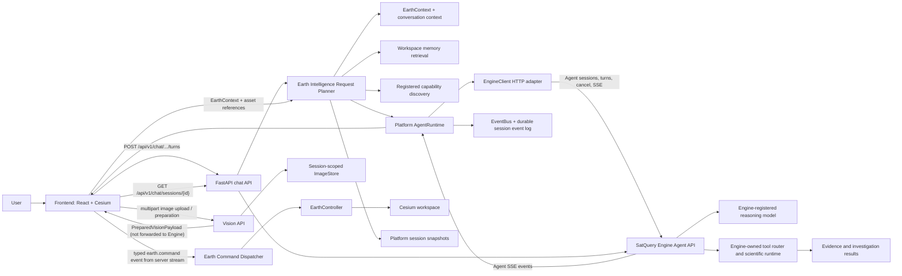

# Architecture overview

## Principles

1. **The Engine is a dependency, not part of the Platform.** All contact goes through
   `engine.EngineClient`. Nothing else imports Engine code. (ADR 0001)
2. **The LLM thinks, the Engine executes.** No science runs in the Platform or in a prompt. (ADR 0002)
3. **The Earth is the workspace.** The globe is mounted once and persists; the UI floats above it, and
   the backend can drive it with typed commands. (ADR 0003)
4. **One wire contract.** Events, Earth commands and shared models are defined once in pydantic,
   exported to `contracts/schema.json`, and generated into TypeScript. The two sides cannot drift.
5. **Everything extensible goes through a registry.** First-party features and plugins use the same
   registries, so the extension API is exercised by the core.
6. **Dependencies point down.** Enforced mechanically, not by convention.

## Runtime view

## Phase 2 text question, end to end

1. The user selects a Platform session and submits text. Investigation execution authorization is
   off by default; the UI checkbox is explicit per-turn consent. The client also sends its current
   typed EarthContext and provider-neutral vision metadata/asset references when present.
2. The chat API verifies the Platform session and configured Engine model id. The Request Planner
   reads the Engine-owned transcript, builds and persists a bounded Platform EarthContext snapshot,
   retrieves existing Platform records, resolves asset metadata by session-owned IDs, discovers
   registered/configured capabilities, and estimates context size.
3. If EarthContext exists, the planner serializes descriptive UI state into a clearly delimited text
   context block and appends it to the user's Engine message. This is the only supported way to
   convey it through today's text-only Agent API. The frontend removes that block when it renders
   the user's transcript. Image attachment IDs are rejected from turn submission before the Engine
   Agent turn is called; they are never silently dropped or submitted as fake structured fields.
4. `AgentRuntime` lazily creates and persists the matching Engine Agent session id for older and new
   Platform sessions. `EngineClient` sends the planned message, model id, and consent flag to
   `POST /api/v1/agent/sessions/{id}/turns`. SatQuery Engine owns model selection, tool calls,
   scientific execution, and transcript persistence.
5. The adapter parses Engine SSE events into typed boundary models. `AgentRuntime` wraps each event
   without interpreting or recalculating it, persists it to the Platform event log, and forwards it
   as SSE to the chat request.
6. The frontend renders assistant deltas and Engine tool/progress status. On session revisit, it
   fetches the authoritative transcript from the Engine Agent session.

The same planner is inspectable without starting a turn at
`POST /api/v1/chat/sessions/{id}/plan`. The Platform memory search endpoint is
`GET /api/v1/intelligence/sessions/{id}/memory?query=...`; runtime capability facts are available
at `GET /api/v1/intelligence/capabilities`.

An Engine-originated Earth command, when supported by the Engine event contract, must arrive as a
typed `earth.command` event. The frontend dispatches that event to the relevant EarthController;
commands are never inferred from assistant prose or tool outputs. The current Engine Agent event
allowlist does not include that event yet, so the dispatcher is an extension point and currently
only `fly_to` has a registered workspace handler. See the [Phase 3 and Phase 4 roadmap](roadmap.md).

The Phase 4 timeline is a presentation-only EarthController slice. Its UI changes the Cesium clock,
and clock state is mirrored into the frontend EarthContext store. Phase 6 includes the serializable
EarthContext as descriptive text in the Engine message; there is still no structured Engine context
field. Investigation visualization and layer rendering similarly require typed Engine-owned source
data; the Platform does not derive these from opaque tool results.

Phase 4 workspace state is kept separate from Engine-owned session transcripts. The Platform's
session record has an `earth_workspace` value persisted through the existing session API and SQLite
store: bounded camera history and named EarthContext bookmarks. EarthController owns Cesium picking,
draw interaction, terrain-height queries, camera restoration, and entity rendering; the frontend
state stores only serializable selection/drawing values. A typed Earth event bus publishes selection
and drawing changes to every active view. Split view creates a second EarthController that shares
presentation events and timeline state while cameras remain independent unless the user enables
synchronization.

Distance, area, coordinate inspection, and optional terrain elevation are local workspace
measurements, not Engine evidence. User-created GeoJSON drawings remain EarthContext presentation
objects and never start an investigation. EarthContext presentation state is sent as descriptive
message text only; it is not treated as an Engine structured input. The Platform does not
synthesize investigation overlays or scientific layers.

## Vision intake and preparation

Vision is a Platform-owned ingestion boundary, not a vision model or scientific subsystem. Browser
file, clipboard, drag/drop, screen-capture, and Cesium viewport-capture sources converge on the
frontend Vision module. Cesium remains hidden behind `EarthController`; a capture is recorded with
camera and timestamp metadata in the serializable EarthContext/session workspace. The current
controller captures a full viewport; the Vision UI can crop a user-selected pixel rectangle from
that image and records its pixel coordinates/dimensions. The Platform does not derive geographic
bounds from that crop.

The backend Vision API verifies the Platform session, validates image size/type/encoding, writes
original data plus thumbnails through `ImageStore`, and exposes session-scoped metadata/content
operations. The `MultimodalPreparer` resolves asset IDs from that store and returns a
`PreparedVisionPayload` with metadata and original image bytes in a provider-neutral envelope.
Client-supplied metadata can describe the image but cannot replace stored asset metadata.

The chat composer does not forward these payloads to SatQuery Engine: the current Engine Agent
request schema is text-only. The request planner validates session-owned asset IDs and may include
stored metadata in its neutral plan, but the chat route rejects attached-image turns before sending
an Engine request. The current composer prepares selected images and clearly tells the user that no
turn was submitted. An Engine-owned multimodal request/persistence contract is required before
image bytes can be passed through `EngineClient`. Vision does no object detection, segmentation,
geolocation inference, or scientific reasoning.

## Phase 6 context and request planning

The `intelligence/` backend layer sits above Agent, Vision, Engine, Earth, and session modules. It
does not execute model/tool calls. Its EarthContext Builder combines the client workspace snapshot
with saved camera history, bookmarks, captures, pinned evidence references, timeline focus, and
prior Platform snapshots. The resulting Pydantic context is stored on the Platform `Session` record;
SQLite persists it in the existing JSON session payload, so no database schema migration is needed.

Conversation context is derived from the Engine transcript and has configurable message and token
limits. The history compressor keeps recent messages and may create short, extractive excerpts from
older transcript text; it does not invent a summary. This normalized history is not resent because
the Engine already owns its transcript and the current API cannot accept a replacement history or
token budget. Likewise, the token estimate is based on UTF-8 bytes divided by four, not any model's
tokenizer, and cannot measure the Engine's hidden conversation history.

Workspace memory indexes records that exist in Platform persistence: session/conversation content,
saved investigations and evidence IDs, typed investigation progress events, image metadata,
bookmarks, drawings, and EarthContext snapshots. Ranking combines word overlap, geographic
proximity, and timeline recency. No embedding model is installed, and opaque Engine tool results or
assistant prose are not parsed into science or evidence. The index is reconstructed from SQLite and
image metadata for each query; an FTS/vector-backed persistent index is a future scale extension.
The active session's Engine transcript is included directly; cross-session conversation search
uses only Platform-persisted conversations rather than fanning out to Engine sessions. Cross-session
retrieval assumes a single trusted workspace because user/tenant authentication is not implemented;
owner filtering is required before shared-user deployment.

Capability snapshots derive provider availability from configuration plus registered factories,
tool sources and layer IDs from their registries, and workspace/command contracts from their typed
models. A present contract is not conflated with a live runtime handler. Provider vision/attachment
support, active browser Earth command handlers, Engine tool inventory, and Engine datasets are
reported as unknown when the current interfaces do not expose them. Recommendations reference
existing records only; unavailable Engine tool/dataset catalogues yield no such recommendations.

Prompt assembly is provider-neutral. It includes a marked JSON context block only when there is
actual Earth, vision, or retrieved workspace context. The current Engine's text message is the only
transport supported for Earth context; a future structured Engine contract should replace this text
serialization rather than adding vendor formatting to the Platform. Uploaded image bytes remain
outside the Engine request.

## Boundaries that matter

| Boundary | Rule |
|---|---|
| Platform ↔ Engine | Only `engine/`; `EngineClient` delegates to the existing Agent API; events/results remain opaque |
| Platform ↔ LLM vendors | Only `llm/providers/*`; neutral `Message`/`LLMRequest`/`LLMChunk` everywhere else |
| Request planning | `intelligence/` builds context and plans; only the unchanged `EngineClient` boundary sends a turn |
| Backend ↔ Frontend | `contracts/schema.json` and the REST/stream endpoints |
| Frontend ↔ Cesium | Only `earth/`, through `EarthController` |
| Core ↔ Plugins | Only `plugins/api.py` and `frontend/src/plugins/types.ts` |

## Concurrency and lifetime

Chat turns currently live for the lifetime of the POST/SSE request. The Platform persists each
forwarded event before sending it, and its GET stream endpoint supports replay by per-session
sequence. A disconnected chat request closes the upstream Engine stream; the Platform does not yet
provide a durable run worker or resume an interrupted model turn. The Engine cancel endpoint is
available through the Platform API.

## Failure model

All client-visible errors derive from `PlatformError` and serialise as
`{ "error": { "code", "message", "details" } }`. Missing Engine configuration or upstream failures
are surfaced as explicit availability errors; Engine turn failures after stream start are persisted
as `run.failed` events. A missing Engine yields degraded readiness rather than a crash.

## Deliberately not decided yet

The current Engine adapter targets its published HTTP Agent API; the Engine must have a compatible
reasoning model registered, configured as `agent.model_id`. Provider SDKs are deliberately not
reimplemented or called directly by the Platform Agent runtime. Engine image input, Earth-context
forwarding, Engine-originated Earth command events, visualization of returned evidence, worker
recovery, authentication, and multi-worker
event delivery remain future work; see [Phase 2 status](phase-2-agent-runtime.md).
