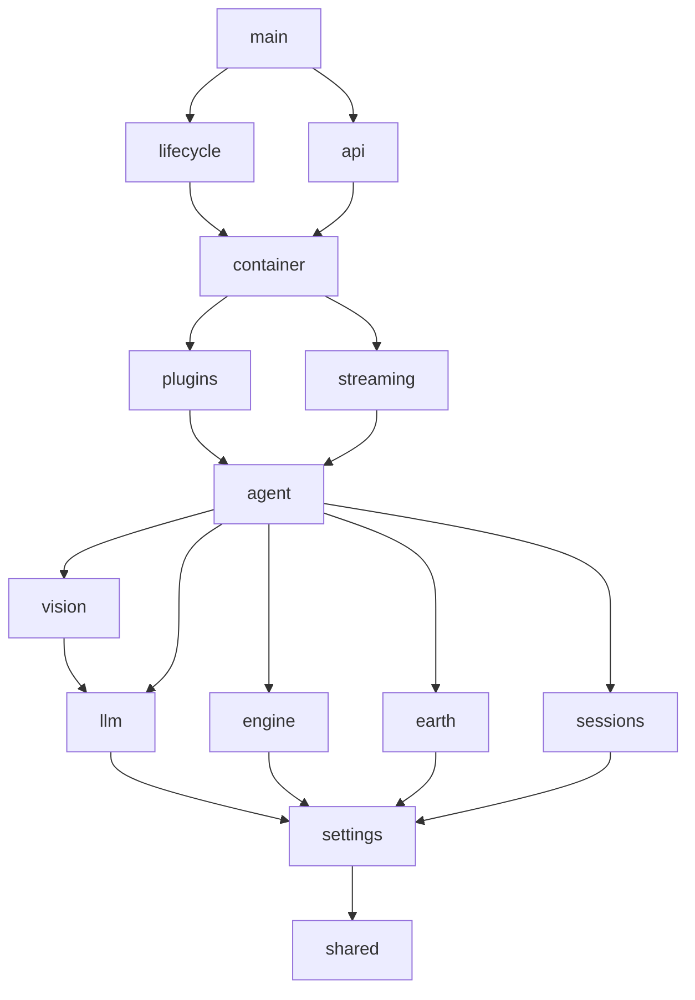
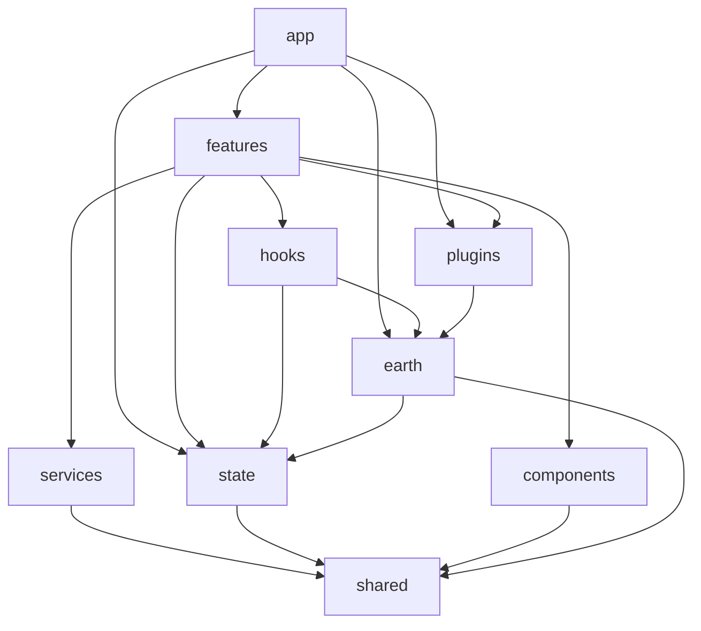
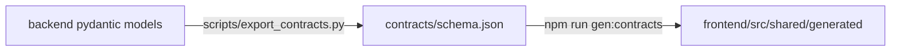

# Dependency graph

## Backend layers (enforced)

An arrow means "may import". Modules on the same row never import each other. The rule lives in
`backend/pyproject.toml` (`[tool.importlinter]`) and runs as `make lint-imports` and in CI.

| Layer (top to bottom) | Modules |
|---|---|
| 1 | `main` |
| 2 | `lifecycle`, `api` |
| 3 | `container` |
| 4 | `plugins`, `streaming` |
| 5 | `agent` |
| 6 | `vision` |
| 7 | `llm`, `engine`, `earth`, `sessions` |
| 8 | `settings` |
| 9 | `shared` |

## Frontend

`earth` is the only folder importing `cesium`. `features` never import each other.

## Cross-stack

